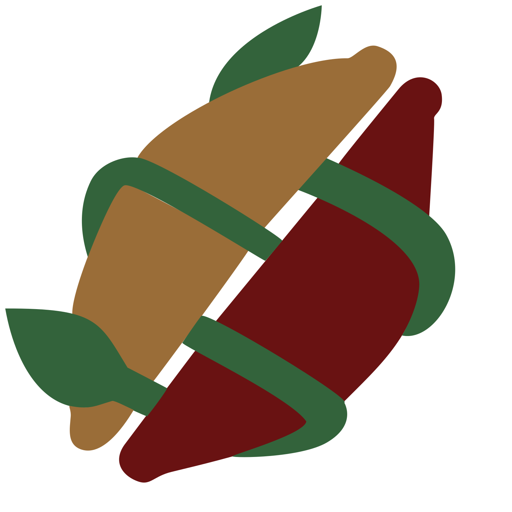
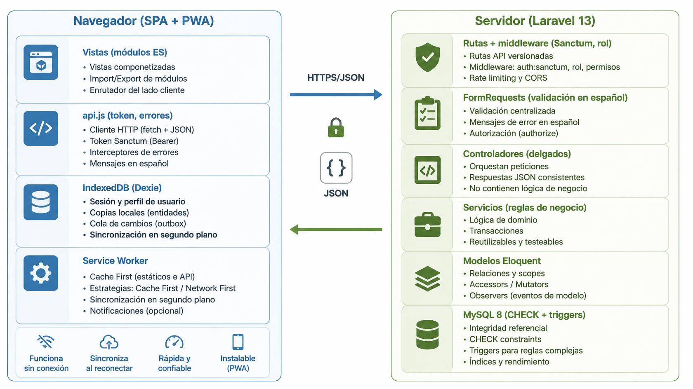

<div>

</div>


# Kakawa · Cacao con historia, calidad y valor

Sistema para que una asociación cacaotera del Huila **registre, transforme y comercialice** su cacao con **trazabilidad verificable**, incluso en zonas **sin conexión a internet**.

Proyecto del equipo **Kakawa** para el **II Hackathon de Programación USCO** (reto oficial de Agroindustria, Semillero DEVURITY).

> Los datos incluidos (lotes, productores, precios) son **simulados** con fines de demostración.

---

## Tabla de contenido

1. [Qué hace](#qué-hace)
2. [Arquitectura](#arquitectura)
3. [Requisitos](#requisitos)
4. [Instalación en Linux (Ubuntu)](#instalación-en-linux-ubuntu)
5. [Instalación en Windows](#instalación-en-windows)
6. [Usuarios de demostración](#usuarios-de-demostración)
7. [Uso sin conexión (PWA)](#uso-sin-conexión-pwa)
8. [Comandos útiles](#comandos-útiles)
9. [Pruebas](#pruebas)
10. [Estructura del proyecto](#estructura-del-proyecto)
11. [Seguridad y buenas prácticas](#seguridad-y-buenas-prácticas)
12. [Declaración de uso de inteligencia artificial](#declaración-de-uso-de-inteligencia-artificial)
13. [Componentes externos y licencias](#componentes-externos-y-licencias)
14. [Equipo](#equipo)

---

## Qué hace

| Módulo | Descripción |
|---|---|
| **Recepción de lotes** | Origen, productor, fecha y kilos recibidos. Identificador automático (CAC001, CAC002…). |
| **Transformación** | Fermentación, secado, tostión… Un solo lote por operación, sin consumir más de lo disponible y con merma calculada. |
| **Trazabilidad** | Recorrido completo del lote al producto, con balance de masa por etapa. |
| **Alertas** | Merma por encima del umbral (15 %), registros incompletos y costos mayores al precio. Cada alerta explica su causa y su regla. |
| **Calidad** | Liberar o bloquear lotes y productos, siempre con motivo. Bloquear un lote bloquea sus productos. |
| **Costos y precios** | Costo unitario y margen con fórmulas visibles. Solo los ve el administrador. |
| **Auditoría** | Quién cambió qué y cuándo, con el valor anterior y el nuevo. No se puede borrar. |
| **Respaldos** | Copia y restauración verificables por conteos y huellas por tabla. |
| **Sitio público** | Catálogo con filtros, ficha de trazabilidad por código o QR (sin datos privados) y registro de compradores. |
| **Compradores** | Tienda con precios, solicitudes de compra y respuesta del administrador. |
| **Sin conexión** | La app abre sin internet, guarda los cambios en el equipo y los sincroniza al volver la señal. |
| **Asistente** | Chat en la página de inicio que responde sobre catálogo, trazabilidad y compras, con o sin conexión. |

**Un solo inicio de sesión:** el servidor reconoce el rol (administrador, operador o comprador) y lleva a cada usuario a su espacio. El registro público solo crea compradores.

---

## Arquitectura

**Cliente-servidor.** Un backend monolítico en capas expone una API REST, y lo consume un frontend SPA progresivo *offline-first*.

<div>


</div>


- **Permisos en tres niveles:** en la ruta, dentro del servicio y al filtrar la respuesta por rol (el operador nunca recibe costos).
- **Idempotencia:** cada transformación lleva un `operacion_id`, y la sincronización usa un `id_temporal`. Si algo se reenvía, no se aplica dos veces.
- **Sin conexión:** el Service Worker (`public/sw.js`) guarda toda la interfaz. IndexedDB guarda la sesión, las consultas y la cola de cambios. `POST /api/sincronizar` aplica la cola en lote con las mismas validaciones y los mismos servicios.

La referencia completa de la API está en [`docs/BACKEND_API.md`](docs/BACKEND_API.md) *(si se incluye en el repositorio)*.

---

## Requisitos

| Herramienta | Versión | Para qué |
|---|---|---|
| PHP | **8.3 o superior** | Laravel 13. Extensiones: `pdo_mysql`, `mbstring`, `openssl`, `fileinfo`, `zip`, `curl` |
| Composer | 2.x | Dependencias de PHP |
| MySQL | **8.0 o superior** | Base de datos. Se necesita MySQL: usa CHECK y triggers, no funciona con SQLite. |
| Git | cualquiera | Clonar el repositorio |
| Navegador | Chrome, Edge o Firefox recientes | La app y el modo sin conexión |
| Node.js *(opcional)* | 18 o superior | Solo para revisar la sintaxis JS con `node --check`. No hay paso de compilación. |

---

## Instalación en Linux (Ubuntu)

<div>

</div>

----


```bash
# 1. Dependencias del sistema
sudo apt update
sudo apt install -y php8.3 php8.3-cli php8.3-mysql php8.3-mbstring php8.3-xml php8.3-curl php8.3-zip unzip git mysql-server
# Composer: https://getcomposer.org/download/

# 2. Código
git clone <URL-DEL-REPOSITORIO> Kakawa-app
cd Kakawa-app
composer install

# 3. Configuración
cp .env.example .env
php artisan key:generate
```

Edite `.env` con los datos de su MySQL:

```dotenv
DB_CONNECTION=mysql
DB_HOST=127.0.0.1
DB_PORT=3306
DB_DATABASE=Kakawa_DB
DB_USERNAME=kakawa
DB_PASSWORD=una_clave_segura
```

```bash
# 4. Base de datos (principal y de pruebas)
sudo mysql -e "CREATE DATABASE Kakawa_DB CHARACTER SET utf8mb4 COLLATE utf8mb4_unicode_ci;
               CREATE DATABASE Kakawa_DB_test CHARACTER SET utf8mb4 COLLATE utf8mb4_unicode_ci;
               CREATE USER IF NOT EXISTS 'kakawa'@'localhost' IDENTIFIED BY 'una_clave_segura';
               GRANT ALL ON Kakawa_DB.* TO 'kakawa'@'localhost';
               GRANT ALL ON Kakawa_DB_test.* TO 'kakawa'@'localhost';"

# 5. Tablas y datos de demostración
php artisan migrate:fresh --seed

# 6. Ejecutar
php artisan serve
```

Abra **http://localhost:8000**: la raíz redirige a la página de inicio, `/app/inicio.html`.

**Desde un celular en la misma red:**

```bash
php artisan serve --host=0.0.0.0 --port=8000
hostname -I          # muestra la IP del equipo, por ejemplo 192.168.1.212
```

En el celular abra `http://<IP>:8000`. Por http con IP el modo sin conexión **no** se activa; vea [Uso sin conexión](#uso-sin-conexión-pwa).

---

## Instalación en Windows

<div>

</div>


**Opción recomendada: [Laragon](https://laragon.org/)**, que trae PHP, MySQL y Composer. Verifique que use **PHP 8.3 o superior** y **MySQL 8**. También sirve PHP oficial + Composer + MySQL Installer.

En **PowerShell**:

```powershell
# 1. Código
git clone <URL-DEL-REPOSITORIO> Kakawa-app
cd Kakawa-app
composer install

# 2. Configuración
Copy-Item .env.example .env
php artisan key:generate
notepad .env      # complete DB_DATABASE, DB_USERNAME y DB_PASSWORD como en Linux
```

Cree las bases desde HeidiSQL, que viene en Laragon, o desde la consola de MySQL:

```sql
CREATE DATABASE Kakawa_DB CHARACTER SET utf8mb4 COLLATE utf8mb4_unicode_ci;
CREATE DATABASE Kakawa_DB_test CHARACTER SET utf8mb4 COLLATE utf8mb4_unicode_ci;
```

```powershell
# 3. Tablas, datos y servidor
php artisan migrate:fresh --seed
php artisan serve
```

Abra **http://localhost:8000**.

**Problemas frecuentes en Windows**

| Síntoma | Solución |
|---|---|
| `could not find driver` | En `php.ini`, quite el `;` de `extension=pdo_mysql` y reinicie la consola. |
| Composer pide `ext-zip` o `ext-fileinfo` | Active `extension=zip` y `extension=fileinfo` en `php.ini`. |
| `php` no se reconoce | Agregue la carpeta de PHP al PATH, o use la terminal de Laragon. |
| Puerto 8000 ocupado | Use `php artisan serve --port=8080`. |

---

## Usuarios de demostración

Los crea `php artisan migrate:fresh --seed`:

| Rol | Usuario | Contraseña |
|---|---|---|
| Administrador | `admin` | `Admin2026*` |
| Operador | `operador` | `Operador2026*` |
| Comprador | `comprador` | `Comprador2026*` |

> Solo para demostración. En un entorno real se cambian estas contraseñas y no se ejecuta el seeder.

---

## Uso sin conexión (PWA)

El navegador solo activa el Service Worker en **https://** o en **http://localhost**.

**Probar en el computador**
1. Abra `http://localhost:8000/app/index.html` **con** el servidor encendido, inicie sesión y espere unos 10 segundos. En ese tiempo se guardan la interfaz y los datos de todas las secciones.
2. Cierre el navegador.
3. Detenga el servidor con `Ctrl+C`. Apagar el WiFi no basta, porque el servidor es local y sigue respondiendo.
4. Abra el navegador otra vez: la app entra con la sesión guardada.
5. Registre lotes o transformaciones. Encienda el servidor: los cambios se sincronizan solos. La vista **Sincronización** muestra lo pendiente, lo rechazado y lo enviado.

**Recomendaciones**
- Sin red, recargue con **F5**. `Ctrl+Shift+R` se salta el Service Worker.
- En DevTools, en la pestaña Application, la sección Service Workers no debe tener marcado **"Bypass for network"**.

**Celulares y zonas rurales:** se necesita https. Para una demostración puede usar un túnel gratuito:

```bash
cloudflared tunnel --url http://localhost:8000   # entrega una dirección https://….trycloudflare.com
```

El usuario abre esa dirección **una vez con señal** e inicia sesión. Después trabaja sin internet.

**Después de cambiar archivos de la interfaz**, actualice la versión del Service Worker:

```bash
sed -i "s/^const VERSION = .*/const VERSION = 'kakawa-$(date +%Y%m%d%H%M%S)';/" public/sw.js
```

---

## Comandos útiles

| Comando | Qué hace |
|---|---|
| `php artisan migrate:fresh --seed` | Instalación limpia con usuarios y lotes de demostración |
| `php artisan kakawa:sinteticos` | Crea 25 lotes sintéticos × 4 etapas (prefijo SIN) |
| `php artisan kakawa:medir` | Mide el rendimiento y guarda la evidencia en `storage/app/evidencias` |
| `php artisan kakawa:respaldar` | Crea un respaldo |
| `php artisan kakawa:verificar-respaldo <archivo>` | Comprueba la integridad de un respaldo |
| `php artisan kakawa:restaurar <archivo>` | Restaura un respaldo, antes guardando una copia del estado actual |
| `php artisan test` | Ejecuta las pruebas automatizadas |

---

## Pruebas

```bash
php artisan test
```

Usan la base `Kakawa_DB_test`, que se limpia en cada prueba. Cubren:
- Recepción y transformación, con inventario, idempotencia y concurrencia.
- Costos y permisos por rol, y la ficha pública sin datos privados.
- Bloqueo en cascada, auditoría, exportación y respaldos.
- Compradores y solicitudes, y la sincronización sin conexión (`SincronizacionTest`).

---

## Estructura del proyecto

```
app/
  Enums/                 Rol, Estado
  Exceptions/            ReglaNegocioException (errores de negocio en JSON)
  Http/Controllers/Api/  Controladores de la API
  Http/Middleware/       RequiereRol
  Http/Requests/         Validaciones (FormRequests)
  Models/                Lote, Producto, Transformacion, Auditoria, Solicitud, Sincronizacion, User
  Services/              Lógica: lotes, transformaciones, estados, trazabilidad, análisis, clientes, sincronización, respaldos
  Console/Commands/      kakawa:* (respaldos, datos sintéticos, medición)
database/migrations/     Tablas, CHECK y triggers
routes/api.php           Rutas de la API con permisos por rol
public/sw.js             Service Worker (raíz del sitio)
public/app/
  inicio.html            Sitio público: catálogo, acceso, asistente
  index.html             Aplicación por rol
  ficha.html             Ficha pública de trazabilidad (QR)
  css/organico/          Estilos por pantalla
  js/                    api, sesión, enrutador, vistas, componentes
  js/offline/            IndexedDB, consultas guardadas y cola de sincronización
  js/asistente/          Motor y ventana del asistente
  vendor/dexie.mjs       Dexie.js (IndexedDB)
tests/                   Pruebas Feature y Unit
```

---

## Seguridad y buenas prácticas

- **Validación en el servidor:** toda entrada pasa por FormRequests y las reglas viven en los servicios. Ocultar un botón en la interfaz nunca es la protección.
- **Permisos por rol** en la ruta, en el servicio y en la respuesta.
- **Ficha pública con lista blanca:** solo publica origen, etapas, kilos y merma. Costos, precios, responsables e incidencias no salen.
- **Base de datos como última defensa:** restricciones CHECK y triggers que impiden consumir de más y borrar la trazabilidad.
- **Frontend:** CSP estricta (`script-src 'self'`), sin `innerHTML` con datos y sin dependencias desde CDN.
- **Contraseñas** con hash (bcrypt). El inicio de sesión responde lo mismo si el usuario no existe o si la clave es incorrecta. Hay límite de intentos.
- **Tokens** de Sanctum con expiración de 12 h. Cerrar sesión borra el token y las copias locales con datos privados.
- **Accesibilidad:** etiquetas en los formularios, foco visible, regiones `aria-live`, navegación con teclado y respeto por `prefers-reduced-motion`.
- **Secretos:** `.env` no se sube al repositorio, solo `.env.example`.

---

## Declaración de uso de inteligencia artificial

El reto permite usar IA con declaración y exige que el equipo comprenda y verifique lo generado. Esta sección documenta cómo la usamos.

### Herramienta y modelo

| Campo | Detalle |
|---|---|
| Herramienta | **Claude**, de Anthropic, en su modo de trabajo con herramientas (escribir y ejecutar código en un espacio de trabajo aislado) |
| Modelo | **Claude Opus 5.5** (`claude-opus-5-5`), el modelo configurado en la sesión. La plataforma puede cambiar el modelo que atiende cada respuesta. |
| Período de uso | 15 y 16 de octubre de 2026, durante el hackathon |
| Uso dentro del producto | **Ninguno.** Kakawa no llama a servicios de IA. El asistente de `inicio.html` funciona con reglas y palabras clave en el navegador: no es IA generativa, no tiene costo y funciona sin internet. |

### Qué hizo la IA y qué hizo el equipo

| La IA (asistente de programación) | El equipo Kakawa |
|---|---|
| Propuso la arquitectura y generó el código del backend (migraciones, servicios, controladores, validaciones, pruebas) | Definió los requisitos a partir del reto, priorizó y tomó las decisiones de producto |
| Generó el frontend: vistas, estilos, sitio público, tienda, modo sin conexión y asistente | Eligió la paleta de colores, el estilo visual, el logo y la imagen de fondo, y pidió cada ajuste |
| Escribió scripts de instalación y parches, y verificó en un entorno aislado | Ejecutó todo en su propio equipo, revisó los resultados y reportó los errores encontrados |
| Explicó causas de errores y propuso correcciones | Validó el funcionamiento, integró los cambios en el repositorio y preparó la demostración |

### Prompts utilizados

Estos son los pedidos principales, en el orden en que se hicieron. Se corrigió la ortografía, pero no el sentido.

**Backend y núcleo (RF01–RF12)**
1. Construir el backend en Laravel 13 + MySQL para el reto "Cacao con historia, calidad y valor": recepción, transformación, trazabilidad, alertas de merma, costos, calidad, auditoría, respaldos y exportación, con permisos por rol.

**Frontend y diseño**

2. *"Rediseña el login como está en esta imagen; la imagen de fondo está en la carpeta img y se llama fondo.jpg; de ser posible añade algo de interacción como una transición."*
3. *"Rediseña el menú para que se adapte en dispositivos más pequeños como menú hamburguesa."*
4. *"Quiero un apartado de alertas más moderno y visualmente mucho mejor"* y *"quiero que la prioridad de alerta tenga un tono de rojo o vinotinto."*
5. *"Utilízame esa paleta de colores para el proyecto"* (9A6D38, 691212, 870000, 33673B, D0FFD5) y *"el proyecto tiene mucho rojo, sepa mezclar todos los colores de la paleta."*
6. *"Rediséñame toda la estructura respetando lo que plantea el problema; quiero algo innovador en estilos y animaciones."* Elegimos solo cambios visuales, estilo "orgánico cacao" y avance por pantallas.
7. *"Mejora la ficha.html; además hazme una landing page para el usuario final: si quiere comprar, que le toque crear una cuenta, que pida algunos datos, un usuario y la contraseña, pero que el sistema sepa internamente si es usuario, operador o administrador."*
8. *"Crea un sitio web que funcione como centro de información de la asociación cacaotera… con un catálogo… con un filtro… al ingresar a un lote muestre el historial de trazabilidad (sin los datos privados)… crear cuenta (para compradores) e inicio de sesión que identifique por sí solo si es administrador, comprador u operador."*

**Funcionalidad**

9. *"Hagamos lo del QR con la IP para que se mire desde el celular el recorrido."*
10. *"Implementar la funcionalidad Offline-First (PWA)… Service Worker y Manifest con Cache First… IndexedDB con Dexie.js… sesión persistente… cola de sincronización con `sincronizado`, `id_temporal` y `accion`… endpoint `POST /api/sincronizar`."*
11. *"Quiero implementar un chatbot para el sistema en línea y cuando no esté en línea; el ícono quiero que sea el SVG del logo y que solo esté disponible en inicio.html."*
12. Ajustes visuales: pantalla de carga con el logo girando y centrado, e ilustración SVG en el acceso.
13. *"No deja acceder si se cerró el navegador o si se reinicia la página sin conexión… corrobora si esa es la razón y, si no, busca cuál es el problema."* La IA reprodujo el fallo, identificó la causa real (Service Worker bloqueado en http con IP y fuera del alcance de la raíz) y lo corrigió.

### Reglas y estilo que le dimos a la IA

- Responder **en español**, paso a paso, con archivos completos o parches para pegar en la terminal y comandos de verificación con resultados esperados.
- Respetar el **enunciado del reto**: un solo lote por transformación, no consumir más de lo disponible, motivo obligatorio para bloquear o liberar, ficha pública sin costos y auditoría que no se borra.
- **Paleta oficial** del equipo y estilo **"orgánico cacao"**, con animaciones suaves y respeto por `prefers-reduced-motion`.
- **Sin frameworks ni CDN** en el frontend: HTML, CSS y JS con módulos, y CSP estricta.
- **Seguridad primero:** validar en el servidor, permisos por rol en tres niveles y nada de `innerHTML` con datos.
- **Código y mensajes en español** y comentados, para que todo el equipo pueda leerlo y explicarlo.

### Cómo verificamos lo generado

- **Pruebas automatizadas** (`php artisan test`) ejecutadas por nosotros, con MySQL real.
- **Revisión de sintaxis** con `php -l` y `node --check`. Los scripts de instalación revisan además que las llaves de CSS estén balanceadas.
- **Pruebas en navegador** hechas por la IA en su entorno aislado con Playwright, en escritorio y celular, sin conexión y tras cerrar y reabrir el navegador. Usaron una **API simulada**: no reemplazan las pruebas con el backend real, que el equipo hizo en su equipo.
- **Pruebas manuales** del equipo: inicio de sesión por rol, compra, bloqueo de lote, QR desde el celular y trabajo sin conexión.
- Ante cada error reportado, la IA reprodujo el problema antes de corregirlo, y el equipo confirmó la corrección.

### Limitaciones y responsabilidades

- La IA puede equivocarse. Todo el código se revisó y se probó antes de integrarlo, y el equipo es responsable del resultado.
- El entorno de la IA no tenía acceso a Packagist, así que el endpoint de sincronización no se ejecutó con Laravel en ese entorno. Su verificación la hizo el equipo con `SincronizacionTest`.
- No se compartieron datos personales reales con la IA: todos los datos son simulados.

---

## Componentes externos y licencias

| Componente | Uso | Licencia |
|---|---|---|
| [Laravel 13](https://laravel.com) y Laravel Sanctum | Framework del backend y tokens de API | MIT |
| [Dexie.js 4.0.11](https://dexie.org) | Acceso a IndexedDB (modo sin conexión) | Apache-2.0 |
| [Fraunces](https://fonts.google.com/specimen/Fraunces) | Tipografía de títulos | SIL Open Font License 1.1 |
| Generador de QR propio | Basado en el algoritmo de referencia de Project Nayuki | MIT (algoritmo de referencia) |
| `img/Logo.svg` | Logo del equipo | *[completar: autoría]* |
| `img/fondo.jpg` | Fotografía de fondo del inicio | *[completar: origen y licencia]* |

Servicios externos: **ninguno es obligatorio.** La app funciona en red local o sin internet. El túnel `cloudflared` es opcional y solo se usa para demostrar https en celulares.

---

## Equipo

**Los Guachiturros**: *Darlys Melissa Guanay, Jose Alejandro Montenegro, Manuel Santiago Ramirez*

II Hackathon de Programación · Universidad Surcolombiana (USCO) · Semillero DEVURITY · 2026